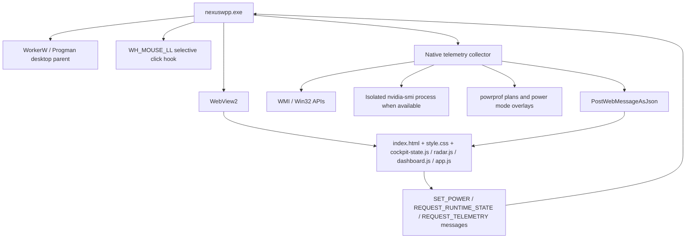

# NexusWpp Architecture

## Runtime

## Startup Path

1. Windows starts `nexuswpp.exe` through `HKLM\...\Run` for the EXE installer, or through the packaged `windows.startupTask` for MSIX.
2. A named mutex keeps only one instance alive.
3. WebView2 starts immediately off screen and loads `http://nexuswpp.local/index.html` through a virtual host folder mapping.
4. A 100 ms timer asks Explorer to create the wallpaper layer and searches for `WorkerW`.
5. If `WorkerW` is not ready after 800 ms, the host temporarily attaches to `Progman` so the wallpaper appears sooner.
6. Once attached, the host covers the virtual screen and keeps listening for display changes.

## Telemetry

Telemetry is collected in `TelemetryCollector.cs`. `NvidiaTelemetry.cs` isolates driver reads in a bounded helper process and invalidates failed readings. `WindowsGpuTelemetry.cs` reads engine and memory counters for all adapters. Live counters (memory, system, CPU clock, GPU/NPU engines and memory, per-process CPU and private memory) come from persistent native PDH queries in `PdhCounters.cs` with English counter paths, sampled once per collection (about 50 ms instead of about 1.4 s through WMI). WMI is kept for one-time hardware inventory and a few light reads. DOM-independent freshness and alert rules live in `telemetry-state.js`.

- CPU load: `GetSystemTimes`
- Thermal reading: Windows thermal zone counters or ACPI `MSAcpi_ThermalZoneTemperature`, explicitly labelled as a thermal zone rather than a CPU core sensor
- CPU frequency: `% Processor Performance` PDH counter scaled by its `Processor Frequency` base
- RAM: `GlobalMemoryStatusEx` plus PDH memory counters; type and module count from SMBIOS
- Disk: PDH `LogicalDisk(%SystemDrive%)` read/write bytes, `% Disk Time` and `Avg. Disk sec/Transfer`
- Network: PDH `Network Interface(*)` byte rates of the physical adapters; identity (name, type, address, link speed, gateway) enumerated only on Windows network change notifications or every 30 s; offline sends type `none` with empty fields. Wi-Fi signal from `wlan_intf_opcode_rssi` (dBm, not gated by location consent). Async ping to `1.1.1.1`, then `8.8.8.8`; the local gateway is a last resort reported as `pingVia: "gateway"` so LAN latency is never shown as internet latency
- GPU/iGPU: DirectX adapter registry (name, LUID, `DedicatedVideoMemory`: 1 GiB or more is discrete, AMD APU names stay integrated) plus GPU performance counters
- NVIDIA details: isolated `nvidia-smi` process (temperature, clocks, power, VRAM), every 5 s on mains, 15 s on battery or energy saver, backing off up to 60 s after failures, and never while the GPU is runtime-suspended (PnP power state D1-D3)
- Other discrete GPUs (AMD, Intel Arc, NVIDIA without nvidia-smi): driver-reported WDDM sensors through `D3DKMTQueryAdapterInfo(ADAPTERPERFDATA)` (temperature, memory clock, fan), the Task Manager source; values only when the driver reports them
- System uptime: `GetTickCount64`
- Power plans: `PowerEnumerate`/`PowerReadFriendlyName` (fallback `powercfg /list` from System32), `PowerGetActiveScheme`, `PowerSetActiveScheme`; buttons ordered by kind (plan GUID, name words, then personality). With a single plan (Modern Standby laptops), the three Windows power modes through `PowerGetEffectiveOverlayScheme`/`PowerSetActiveOverlayScheme`
- Rate readings are rebased after a gap of more than 2.5 s between samples (pause, sleep) instead of averaging the gap

Visible text lives in `i18n.js` (French and English, chosen from the Windows display language through `navigator.language`; `?lang=` overrides it in tests).

The frontend receives telemetry only through WebView2 messages. There is no HTTP server in the current native architecture.

## Settings

A tray icon (`NotifyIcon`) opens the settings window (`SettingsForm.cs`) and quits the app; launching NexusWpp again signals the running instance (named event) to show the same window. The custom center logo is imported by `UserSettings.cs` (center-cropped, 512 px PNG in the user data folder) and sent to the page as `{"control":"SETTINGS","logo":"data:image/png;base64,..."}`; `null` restores the brand logo. Quitting repaints the user's own Windows wallpaper.

## Interaction

The injected WebView2 window lives below desktop icons, so normal mouse delivery is unreliable. The frontend reports the bounds of the power-plan panel with `BOUNDS:left,top,right,bottom`. The host installs a low-level mouse hook and forwards clicks inside that rectangle to Chromium, then swallows those clicks so Windows does not select desktop icons behind the UI.

## Performance Choices

- WebView2 is warmed before `WorkerW` is found.
- The Canvas loop sleeps when particles/interactions stop. The two logo spin rings use `steps()` at 12 frames/s instead of a 60 frames/s compositor animation. When Windows energy saver is on (`SystemStatusFlag`), the rings hold still; values, clock and data packets keep updating.
- Top-process ranking uses its own PDH query sampled every 4 s (CPU averaged over that window) and is protected against overlapping calls.
- A discarded warm-up collection at startup makes the first visible frame show fresh values even after a covered start.
- GPU routing is left to Windows; NexusWpp does not write DirectX GPU preferences.
- A 250 ms coverage check pauses work only when all monitor work areas stay covered for 1.5 s (or the session is inactive). While paused, a WinEvent hook (foreground, move/size end, minimize, show/hide/destroy of top-level windows) re-checks within about 60 ms; the hook exists only while paused. WebView2 stays visible and is never suspended for occlusion; the real composed scene remains available before animation resumes.
- Canvas pixels, particles and critical-state styling survive pause. CSS animations and in-flight transitions pause, clock callbacks stop, and stale asynchronous telemetry is discarded. The page requests runtime state after its listener is ready, including recovery/navigation.
- The mouse hook runs on its own message-pump thread, consuming immutable routing snapshots from the UI thread.
