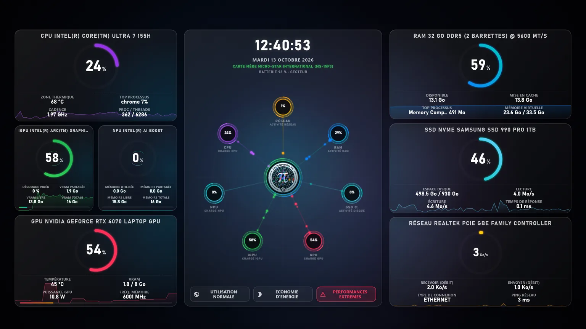

# NexusWpp

**Your PC, at a glance. A live hardware dashboard as your Windows wallpaper.**

[](https://apps.microsoft.com/detail/9N2VCVDH7QDX)
[](CHANGELOG.md)
[](#quick-start)
[](LICENSE)
[](https://scorecard.dev/viewer/?uri=github.com/pironjulien/NexusWpp)



CPU, GPU, integrated graphics, NPU, RAM, SSD and network: load, temperatures, memory and throughput, with the last
60 seconds on every card. Switch power plans from the desktop in one click. It pauses on its own as soon as a window or
a game covers it. No Wallpaper Engine, no Node server: a native Windows app.

**Get it:** [Microsoft Store](https://apps.microsoft.com/detail/9N2VCVDH7QDX) (free) ·
**Project page:** [julienpiron.fr/nexuswpp](https://julienpiron.fr/nexuswpp/)

## How it works

NexusWpp displays a dynamic hardware cockpit directly on the Windows desktop, without Wallpaper Engine. The official mode is the native host `nexuswpp.exe`, which loads `index.html` in WebView2, attaches to the desktop's `WorkerW`/`Progman` layer, then sends telemetry to the frontend through WebView2 messages.

## Goals

- Animated HTML/CSS/Canvas wallpaper beneath the Windows icons.
- Fastest possible startup at sign-in.
- No Node server, no npm dependencies, no Wallpaper Engine.
- Clickable control of Windows power plans from the wallpaper.

## Current Architecture

- `Program.cs` and `DesktopForm*.cs`: WinForms/WebView2 host split by responsibility (lifecycle and desktop, WebView2, pause/resume, telemetry, settings, mouse hook); `NativeMethods.cs`: Win32 declarations.
- `TelemetryCollector.cs`, `NvidiaTelemetry.cs`, `WindowsGpuTelemetry.cs`: native collection and sensor validity.
- `telemetry-state.js`: measurement validity rules and confirmation of high load.
- `DesktopVisibility.cs`: detection of a covered desktop, of full screen, and multi-monitor coverage calculation.
- `index.html`, `style.css` and the scripts loaded in order: `i18n.js` (translations), `cockpit-state.js` (shared state, clock), `radar.js` (Canvas radar, pause), `dashboard.js` (cards, alerts, history), `app.js` (host messages, startup).
- `compile.ps1`: compiles the host and the visibility detection into `bin\nexuswpp.exe`.
- `deploy_local.ps1`: copies the app to `C:\nexuswpp` and configures Windows startup via `HKLM\...\Run`.
- `run.bat`: local menu to start, compile, deploy or stop the app.
- `scripts/benchmark_nexuswpp.ps1`: multi-run CPU/RAM/startup benchmark.
- `scripts/benchmark_fullscreen_suspend.ps1`: legacy benchmark for versions that used the "fullscreen foreground detected" log pattern; for the current policy, use `measure_desktop_suspension.ps1`.
- `scripts/measure_desktop_suspension.ps1`: measures CPU/GPU with the desktop visible, side-by-side windows, full screen and transparent windows, then restores the previous windows.
- `scripts/test_desktop_coverage.cs`: ten geometric scenarios independent of the real desktop (not yet run by a script or by CI).

## Quick Start

Prerequisites:

- Windows 10/11.
- .NET 8 SDK or newer (free) to compile: `NexusWpp.csproj` uses the current C# compiler but targets .NET Framework 4.8, built into Windows, so users have no runtime to install.
- Microsoft Edge WebView2 Runtime.
- NVIDIA is optional; detailed measurements use the isolated `nvidia-smi` process, with Windows counters when that source is unavailable.

```powershell
.\compile.ps1
.\deploy_local.ps1
```

The `VERSION` file is the single source of the version number for the EXE, the installer and the MSIX. To produce a standalone `.exe` installer:

```powershell
.\scripts\build_installer.ps1
```

The generated file is `dist\NexusWppSetup.exe`. It embeds the compiled application, the WebView2 SDK DLLs and the assets. At launch, it requests administrator rights, installs to `C:\nexuswpp`, checks for the WebView2 Evergreen Runtime and downloads it from Microsoft if needed, configures a single Windows startup entry via `HKLM\...\Run`, adds `NexusWpp` to the Start menu, registers NexusWpp in Installed apps with an uninstall command, then starts the wallpaper.

To sign the installer, install the Windows SDK, then set one of the following configurations before the build:

```powershell
$env:NEXUSWPP_SIGN_CERT_THUMBPRINT = "CODESIGNING_CERTIFICATE_THUMBPRINT"
.\scripts\build_installer.ps1
```

or:

```powershell
$env:NEXUSWPP_SIGN_PFX = "C:\certs\nexuswpp.pfx"
$env:NEXUSWPP_SIGN_PFX_PASSWORD = "password"
.\scripts\build_installer.ps1
```

Without a public code-signing certificate, the installer works but may display a SmartScreen warning.

To update an existing installation, simply run a newer `NexusWppSetup.exe`. The installer stops the running instance, replaces the files, cleans up old launchers, keeps a single `HKLM\...\Run` startup entry, updates the Start menu shortcut and restarts the wallpaper. Windows uninstallation uses `C:\nexuswpp\NexusWppSetup.exe /uninstall`.

The installer configures:

- a single `NexusWpp` startup entry in `HKLM\...\Run`;
- a `NexusWpp.lnk` shortcut in the common Start menu;
- an uninstall entry in Installed apps.

The MSIX package configures Windows startup through a packaged `windows.startupTask` startup task, because the EXE installer's `HKLM\...\Run` entries do not apply to Store/MSIX mode. The native host also registers with the Windows Restart Manager so that the Store can automatically restart NexusWpp after an update that closes the running instance.

The application has a single-instance lock, so relaunching `NexusWpp` from the Start menu does not create two wallpapers.

A Store/MSIX installation is updated with a package of the same identity and a higher version number. Do not add the EXE deployment to it, as that uses a different location and a different startup mechanism.

## Pause and return to the desktop

Since version `1.0.24.0`, the « Charge élevée » (High load) and « Mémoire très utilisée » (Memory heavily used) badges appear after at least 90% for five seconds, then disappear at 80% or less for five seconds. They share a line with the title, without flickering or jitter. An interruption in readings resets the confirmation.

A failed NVIDIA reading immediately invalidates the old values. Missing sensors display "—" and stale data is flagged. Watts represent the entire GPU card, not NexusWpp's consumption; the Windows thermal zone is not a CPU core measurement.

The gauge transition goes from 0.55 to 0.18 seconds after A/B profiling in WebView2. Halos, radar and the logo's rotating rings run at 12 frames/s. The `scripts/profile_graphics.ps1` benchmark measures GPU engine utilization for the process group, without attributing watts or the Windows compositor's cost. Sensor and alert rules are verified with `scripts/test_features.ps1`.

Version `1.0.16.0` freezes Canvas/CSS animations, in-progress transitions and the clock when all useful areas of the screens are covered by opaque windows. Telemetry stops new collections. The DOM, particles, values and WebView2 surface stay in place: no hiding of the control, Chromium suspension, navigation or rebuild is needed to see the desktop again.

Detection runs every 250 ms; the pause is only confirmed after 1.5 s of covered desktop. During the pause, window changes (close, minimize, move, foreground) trigger a re-check in about 60 ms. This delay concerns resuming animations and measurements; the scene already displayed remains available to the Windows compositor. A collection finishing after a pause is ignored. Resuming requests new measurements and refreshes the clock. An actual resize redraws the frozen scene once.

Coverage is calculated across all screens without double-counting overlaps. Transparent windows, windows hidden on another virtual desktop and shell surfaces are excluded. A full-screen game on a single monitor lets the desktop still visible on another monitor keep running. Locking or disconnecting the session also pauses the work.

Local version `1.0.15.0` hid and suspended WebView2. Its power consumption measurements did not validate the visual return; this behavior is replaced in `1.0.16.0`.

```powershell
.\scripts\test_runtime_pause.ps1
.\scripts\test_desktop_visual_resume.ps1 -Label installed
```

The first test runs the real page in WebView2 and checks, among other things, Canvas pixels, particles, the first scene and fast transitions. The second captures the composited desktop while maximized, side-by-side, full-screen, partial and transparent windows are removed. It checks the packaged process path, restores the windows and keeps screenshots, measured times and limitations under `work\resume-20260925`. CPU/GPU measurements are done separately with `measure_desktop_suspension.ps1`: a drop in consumption or resume logs alone do not prove the absence of visual disappearance.

## Portability

### Resolutions and scaling

Starting with version `1.0.18.0`, the grid respects both dimensions of the WebView2 viewport and preserves margins for a row of icons at the top and space above the taskbar. Cards adapt the room for their gauges and measurements to their actual size; portrait screens use two columns below the clock and the controls. The radar scales its drawing and mouse coordinates uniformly. Measurements and buttons remain present, without scrolling the desktop cards.

Version `1.0.20.0` refines the distribution of that same vertical reserve: more space at the top for icon labels than in `1.0.18.0`, moved up by 10 pixels at 125% compared with `1.0.19.0`, without resizing the cards. A minimum top margin of 96 CSS pixels keeps the icon row on small formats.

```powershell
.\scripts\test_responsive_layout.ps1 -Label current
```

The harness loads the shipped files in the real WebView2 Evergreen Runtime, with Chromium emulation of the viewport and pixel ratio. It covers 29 physical resolutions from 1280×720 to 7680×4320, at scales of 100, 125, 150, 175, 200, 225, 250, 300, 350 and 400% whenever the logical surface remains at least 800×450 in landscape or 432×768 in portrait. It includes the old CSS thresholds, variants without iGPU/NPU/dedicated GPU, and one to four power plans.

The checks cover off-screen cards, clipped text and controls, overlaps, gauge size and circularity, radar nodes, mouse coordinates and keeping the pause during resizes. Test data stays in the harness and is never embedded in the product. The JSON files and PNG screenshots are in `work\responsive\<Label>`; this emulation test validates neither the overscan of a physical TV nor a multi-monitor topology with different DPIs.

### Installation and hardware

- Hardware is detected automatically via WMI, Win32, Windows network interfaces and `nvidia-smi` when available.
- The MSIX is installed by Windows in `WindowsApps`; only the standalone EXE mode uses `C:\nexuswpp`. Data and the WebView2 profile stay in the local user folder.
- The Start menu shortcut is created in the common Windows folder, not in a hard-coded user path.
- The wallpaper works without a Node server and without npm dependencies.
- The power plan selector confirms the active Windows GUID and ignores clicks when another application covers the panel.
- The first display is the real interface right away, with neutral values. Telemetry then fills in the existing fields as soon as it arrives.

## Why It Is Faster Than Before

The old version waited to find `WorkerW` before initializing WebView2. At Windows startup, this layer can show up late. The current version preloads WebView2 off-screen immediately, looks for `WorkerW` every 100 ms, then temporarily uses `Progman` if `WorkerW` takes too long.

## Notes

- `server.js`, `get-stats.ps1`, `get-startup.ps1` and the SSE stream are no longer part of this architecture.
- Plain browser mode displays the interface, but without telemetry or power plan switching.
- To find the actual MSIX path: `(Get-AppxPackage julienpiron.fr.NexusWpp).InstallLocation`.
- The network ring is calibrated to the actual Windows link speed, for example `2.5 Gb/s` for the Intel I226-V.

## Useful measurements

```powershell
.\scripts\benchmark_nexuswpp.ps1 -DurationSeconds 18 -Runs 3 -Label current -OutputPath .\scripts\last-benchmark.json
.\scripts\compare_benchmark_result.ps1 -BeforePath .\scripts\last-benchmark-before.json -AfterPath .\scripts\last-benchmark-after.json
$package = Get-AppxPackage julienpiron.fr.NexusWpp
.\scripts\measure_desktop_suspension.ps1 -AppPath (Join-Path $package.InstallLocation nexuswpp.exe) -LogPath "$env:LOCALAPPDATA\Packages\julienpiron.fr.NexusWpp_yq2nr3sn86fpg\LocalCache\Local\NexusWpp\webview_debug.log" -OutputPath .\work\desktop-performance.json
```

## Benchmark guardrail

Before keeping an optimization, produce a before/after JSON with `benchmark_nexuswpp.ps1`, then compare:

```powershell
.\scripts\compare_benchmark_result.ps1 -BeforePath .\scripts\last-benchmark-before.json -AfterPath .\scripts\last-benchmark-after.json
```

The verdict is:

- `KEEP` if CPU or RAM drops measurably without regression.
- `REJECT` if errors increase, if CPU/RAM regress beyond tolerances, or if attaching to the desktop slows down too much.
- `NEUTRAL` if nothing regresses, but the gain is not significant.

The legacy fields `SuspendLatencyMs`, `ResumeLatencyMs` and `TelemetryAfterResumeMs` measured when logs were received, not the visual return. The screenshots from the `test_desktop_visual_resume.ps1` harness are the verification of the return to the desktop, complemented by the separate CPU/GPU measurement.
