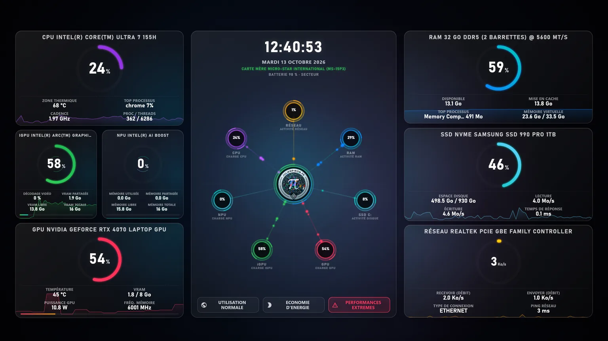
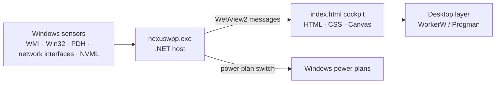

<div align="center">

<a href="https://julienpiron.fr/nexuswpp/"></a>

# NexusWpp

**Your PC, at a glance.**

A live hardware dashboard as your Windows wallpaper: CPU, GPU, NPU, RAM, SSD and network, right under your desktop icons.

[](https://apps.microsoft.com/detail/9N2VCVDH7QDX)
[](CHANGELOG.md)
[](https://github.com/pironjulien/NexusWpp/actions/workflows/ci.yml)
[](https://scorecard.dev/viewer/?uri=github.com/pironjulien/NexusWpp)
[](NexusWpp.csproj)
[](#-quick-start)
[](LICENSE)

**[🌐 Website](https://julienpiron.fr/nexuswpp/)** · **[📦 Get it from the Microsoft Store](https://apps.microsoft.com/detail/9N2VCVDH7QDX)** · **[📝 Changelog](CHANGELOG.md)**

</div>

<div align="center">
<a href="https://julienpiron.fr/nexuswpp/"></a>
<br><sub>The cockpit on a real desktop · <a href="https://julienpiron.fr/nexuswpp/">more on julienpiron.fr</a></sub>
</div>

## ✨ Why NexusWpp

<table>
<tr>
<td width="33%">📊 <b>Every component, live</b><br>CPU, GPU, integrated graphics, NPU, RAM, SSD and network: load, temperatures, memory and throughput, with the last 60 seconds on every card.</td>
<td width="33%">⚡ <b>Power plans in one click</b><br>Switch Windows power plans from the desktop; Windows confirms the active one.</td>
<td width="33%">⏸️ <b>Pauses on its own</b><br>Animations and measurements stop as soon as a window or a game covers the desktop, on every monitor.</td>
</tr>
<tr>
<td width="33%">🪶 <b>Native Windows app</b><br>No Wallpaper Engine, no Node server, no npm: a .NET host with WebView2, fast at sign-in.</td>
<td width="33%">🖥️ <b>Multi-screen, FR/EN</b><br>Landscape or portrait, from 1280×720 to 8K, follows the Windows language and starts with your session.</td>
<td width="33%">🔒 <b>Everything stays local</b><br>No account, no ads, no data collected or sent. Free on the Microsoft Store.</td>
</tr>
</table>

## 🚀 Quick start

> [!TIP]
> **Get it from the [Microsoft Store](https://apps.microsoft.com/detail/9N2VCVDH7QDX)** (free). The Store installs it,
> starts it with Windows and keeps it up to date. It is also listed in the [NexusSystem](https://github.com/pironjulien/NexusSystem) app.

Requirements: Windows 10/11 and the Microsoft Edge WebView2 Runtime. An NVIDIA GPU is
optional: detailed measurements come from NVML, the library of the NVIDIA driver, with Windows counters when that
source is unavailable.

<details>
<summary><b>Standalone installer (verified)</b></summary>

Every release is built by GitHub, not on a PC. Pushing to `main` a `VERSION` that has no `v<VERSION>` release yet runs
[`release.yml`](.github/workflows/release.yml): `test.ps1`, then the Store package (`scripts/build_msix.ps1 -SkipSigning`)
and the installer, `SHA256SUMS.txt`, a [build-provenance attestation](https://docs.github.com/actions/security-for-github-actions/using-artifact-attestations)
of each file, and the immutable release `v<VERSION>` with its `CHANGELOG.md` section and every file attached.
`.\scripts\tag_release.ps1` checks before the push that the version is ready; `.\scripts\tag_release.ps1 -Download`
fetches the release files into `dist\release` and verifies them: its MSIX is the one submitted to the Microsoft Store.

The release files are signed this way:

- the MSIX is uploaded unsigned and signed by the Microsoft Store, which is how users get it;
- `NexusWppSetup.exe` is **not Authenticode-signed**: a self-signed certificate on a CI runner proves nothing to
  Windows, and NexusWpp has no public code-signing certificate. Windows may show a SmartScreen or "unknown publisher"
  warning. Its origin is proven instead by the Sigstore attestation, which ties the file to this repository, the
  workflow and the commit that built it:

```powershell
gh attestation verify NexusWppSetup.exe --repo pironjulien/NexusWpp
```

The same command works on the MSIX; `SHA256SUMS.txt` lists the checksums and `NexusWpp-<VERSION>.intoto.jsonl` is the
attestation bundle, for offline checks.

At launch, `NexusWppSetup.exe` requests administrator rights, installs to `C:\nexuswpp`, checks for the WebView2
Evergreen Runtime and downloads it from Microsoft if needed, configures a single Windows startup entry via
`HKLM\...\Run`, adds `NexusWpp` to the Start menu, registers NexusWpp in Installed apps with an uninstall command, then
starts the wallpaper. The installer configures:

- a single `NexusWpp` startup entry in `HKLM\...\Run`;
- a `NexusWpp.lnk` shortcut in the common Start menu;
- an uninstall entry in Installed apps.

To update an existing installation, simply run a newer `NexusWppSetup.exe`. The installer stops the running instance,
replaces the files, cleans up old launchers, keeps a single `HKLM\...\Run` startup entry, updates the Start menu
shortcut and restarts the wallpaper. Windows uninstallation uses `C:\nexuswpp\NexusWppSetup.exe /uninstall`.

</details>

> [!NOTE]
> Store (MSIX) and standalone installs are separate. The MSIX package configures Windows startup through a packaged
> `windows.startupTask`, because the EXE installer's `HKLM\...\Run` entries do not apply to Store/MSIX mode, and the
> host registers with the Windows Restart Manager so that the Store can restart NexusWpp after an update. A Store/MSIX
> installation is updated with a package of the same identity and a higher version number: do not add the EXE
> deployment to it, as that uses a different location and a different startup mechanism. A single-instance lock means
> relaunching `NexusWpp` from the Start menu never creates two wallpapers.

## ⚙️ How it works

The official mode is the native host `nexuswpp.exe`, which loads `index.html` in WebView2, attaches to the desktop's
`WorkerW`/`Progman` layer, then sends telemetry to the frontend through WebView2 messages.



Goals:

- Animated HTML/CSS/Canvas wallpaper beneath the Windows icons.
- Fastest possible startup at sign-in.
- No Node server, no npm dependencies, no Wallpaper Engine.
- Clickable control of Windows power plans from the wallpaper.

**Why it starts fast.** The old version waited to find `WorkerW` before initializing WebView2. At Windows startup, this
layer can show up late. The current version preloads WebView2 off-screen immediately, looks for `WorkerW` every 100 ms,
then temporarily uses `Progman` if `WorkerW` takes too long.

<details>
<summary><b>Architecture</b></summary>

- `Program.cs` and `DesktopForm*.cs`: WinForms/WebView2 host split by responsibility (lifecycle and desktop, WebView2, pause/resume, telemetry, settings, mouse hook); `NativeMethods.cs`: Win32 declarations.
- `TelemetryCollector.cs`, `NvidiaTelemetry.cs`, `WindowsGpuTelemetry.cs`: native collection and sensor validity.
- `telemetry-state.js`: measurement validity rules and confirmation of high load.
- `DesktopVisibility.cs`: detection of a covered desktop, of full screen, and multi-monitor coverage calculation.
- `index.html`, `style.css` and the scripts loaded in order: `i18n.js` (translations), `cockpit-state.js` (shared state, clock), `radar.js` (Canvas radar, pause), `dashboard.js` (cards, alerts, history), `app.js` (host messages, startup).
- `compile.ps1`: compiles the host and the visibility detection into `bin\nexuswpp.exe`.
- `deploy_local.ps1`: copies the app to `C:\nexuswpp` and configures Windows startup via `HKLM\...\Run`.
- `run.bat`: local menu to start, compile, deploy or stop the app.
- `scripts/benchmark_nexuswpp.ps1`: multi-run CPU/RAM/startup benchmark.
- `scripts/benchmark_fullscreen_suspend.ps1`: legacy benchmark for versions that used the "fullscreen foreground detected" log pattern; for the current policy, use `measure_desktop_suspension.ps1`.
- `scripts/measure_desktop_suspension.ps1`: measures CPU/GPU with the desktop visible, side-by-side windows, full screen and transparent windows, then restores the previous windows.
- `tests/NexusWpp.Tests`: the C# tests on xUnit v3, run by `scripts/test_features.ps1` (so `test.ps1`) and CI: feature rules, the geometric coverage scenarios, and the host's WinForms and WebView2 harnesses (`Harnesses/`: host, settings window, mouse hook, runtime pause, responsive layout), off screen and never activated. Tests that need the real desktop (Store screenshots, visual resume) or take minutes (every resolution) are explicit: `dotnet test` runs them only when asked.

</details>

### Sensors and alerts

Since version `1.0.24.0`, the « Charge élevée » (High load) and « Mémoire très utilisée » (Memory heavily used) badges
appear after at least 90% for five seconds, then disappear at 80% or less for five seconds. They share a line with the
title, without flickering or jitter. An interruption in readings resets the confirmation.

> [!NOTE]
> No value is invented. A failed NVIDIA reading immediately invalidates the old values. Missing sensors display "—" and
> stale data is flagged. Watts represent the entire GPU card, not NexusWpp's consumption; the Windows thermal zone is
> not a CPU core measurement.

The gauge transition goes from 0.55 to 0.18 seconds after A/B profiling in WebView2. Halos, radar and the logo's
rotating rings run at 12 frames/s. The `scripts/profile_graphics.ps1` benchmark measures GPU engine utilization for the
process group, without attributing watts or the Windows compositor's cost. Sensor and alert rules are verified with
`scripts/test_features.ps1`.

### Pause and return to the desktop

Version `1.0.16.0` freezes Canvas/CSS animations, in-progress transitions and the clock when all useful areas of the
screens are covered by opaque windows. Telemetry stops new collections. The DOM, particles, values and WebView2 surface
stay in place: no hiding of the control, Chromium suspension, navigation or rebuild is needed to see the desktop again.

<details>
<summary><b>Pause details and tests</b></summary>

Detection runs every 250 ms; the pause is only confirmed after 1.5 s of covered desktop. During the pause, window
changes (close, minimize, move, foreground) trigger a re-check in about 60 ms. This delay concerns resuming animations
and measurements; the scene already displayed remains available to the Windows compositor. A collection finishing after
a pause is ignored. Resuming requests new measurements and refreshes the clock. An actual resize redraws the frozen
scene once.

Coverage is calculated across all screens without double-counting overlaps. Transparent windows, windows hidden on
another virtual desktop and shell surfaces are excluded. A full-screen game on a single monitor lets the desktop still
visible on another monitor keep running. Locking or disconnecting the session also pauses the work.

Local version `1.0.15.0` hid and suspended WebView2. Its power consumption measurements did not validate the visual
return; this behavior is replaced in `1.0.16.0`.

```powershell
dotnet test --project tests\NexusWpp.Tests --filter-method *RuntimePause
.\scripts\test_desktop_visual_resume.ps1 -Label installed
```

The first test runs the real page in WebView2 and checks, among other things, Canvas pixels, particles, the first scene
and fast transitions. The second captures the composited desktop while maximized, side-by-side, full-screen, partial and
transparent windows are removed. It checks the packaged process path, restores the windows and keeps screenshots,
measured times and limitations under `work\resume-20260925`. CPU/GPU measurements are done separately with
`measure_desktop_suspension.ps1`: a drop in consumption or resume logs alone do not prove the absence of visual
disappearance.

</details>

### Resolutions and scaling

Starting with version `1.0.18.0`, the grid respects both dimensions of the WebView2 viewport and preserves margins for a
row of icons at the top and space above the taskbar. Cards adapt the room for their gauges and measurements to their
actual size; portrait screens use two columns below the clock and the controls. The radar scales its drawing and mouse
coordinates uniformly. Measurements and buttons remain present, without scrolling the desktop cards.

<details>
<summary><b>Layout details and harness</b></summary>

Version `1.0.20.0` refines the distribution of that same vertical reserve: more space at the top for icon labels than
in `1.0.18.0`, moved up by 10 pixels at 125% compared with `1.0.19.0`, without resizing the cards. A minimum top margin
of 96 CSS pixels keeps the icon row on small formats.

```powershell
dotnet test --project tests\NexusWpp.Tests --filter-method *ResponsiveLayoutFull --explicit only
```

The harness loads the shipped files in the real WebView2 Evergreen Runtime, with Chromium emulation of the viewport and
pixel ratio. It covers 29 physical resolutions from 1280×720 to 7680×4320, at scales of 100, 125, 150, 175, 200, 225,
250, 300, 350 and 400% whenever the logical surface remains at least 800×450 in landscape or 432×768 in portrait. It
includes the old CSS thresholds, variants without iGPU/NPU/dedicated GPU, and one to four power plans.

The checks cover off-screen cards, clipped text and controls, overlaps, gauge size and circularity, radar nodes, mouse
coordinates and keeping the pause during resizes. Test data stays in the harness and is never embedded in the product.
The quick subset runs with every `test.ps1`. The JSON files and PNG screenshots are in `work\responsive\quick` or `work\responsive\full`; this emulation test validates neither the overscan
of a physical TV nor a multi-monitor topology with different DPIs.

</details>

### Installation and hardware

- Hardware is detected automatically via WMI, Win32, Windows network interfaces and NVML (NVIDIA driver) when available.
- The MSIX is installed by Windows in `WindowsApps`; only the standalone EXE mode uses `C:\nexuswpp`. Data and the WebView2 profile stay in the local user folder.
- The Start menu shortcut is created in the common Windows folder, not in a hard-coded user path.
- The wallpaper works without a Node server and without npm dependencies.
- The power plan selector confirms the active Windows GUID and ignores clicks when another application covers the panel.
- The first display is the real interface right away, with neutral values. Telemetry then fills in the existing fields as soon as it arrives.

## 🛠️ Development

Prerequisites: Windows 10/11, the .NET 10 SDK (free) and the Microsoft Edge WebView2 Runtime. `NexusWpp.csproj`
targets .NET 10 and is published self-contained, so the Store package and the installer ship the runtime and users have
nothing to install. The installer (`installer/NexusWppInstaller.csproj`) is one self-contained, compressed .NET 10
executable that embeds the application.

```powershell
.\compile.ps1
.\deploy_local.ps1
```

The `VERSION` file is the single source of the version number for the EXE, the installer and the MSIX. To produce a
standalone `.exe` installer:

```powershell
.\scripts\build_installer.ps1
```

The generated file is `dist\NexusWppSetup.exe`. It embeds the compiled application, the WebView2 SDK DLLs and the
assets.

<details>
<summary><b>Signing a local installer build</b></summary>

To sign a local installer build with a real code-signing certificate, install the Windows SDK, then set one of the
following configurations before the build:

```powershell
$env:NEXUSWPP_SIGN_CERT_THUMBPRINT = "CODESIGNING_CERTIFICATE_THUMBPRINT"
.\scripts\build_installer.ps1
```

or:

```powershell
$env:NEXUSWPP_SIGN_PFX = "C:\certs\nexuswpp.pfx"
$env:NEXUSWPP_SIGN_PFX_PASSWORD = "password"
.\scripts\build_installer.ps1
```

Without these variables the installer is left unsigned; it works but may display a SmartScreen warning.

</details>

<details>
<summary><b>Useful measurements and benchmark guardrail</b></summary>

```powershell
.\scripts\benchmark_nexuswpp.ps1 -DurationSeconds 18 -Runs 3 -Label current -OutputPath .\scripts\last-benchmark.json
.\scripts\compare_benchmark_result.ps1 -BeforePath .\scripts\last-benchmark-before.json -AfterPath .\scripts\last-benchmark-after.json
$package = Get-AppxPackage julienpiron.fr.NexusWpp
.\scripts\measure_desktop_suspension.ps1 -AppPath (Join-Path $package.InstallLocation nexuswpp.exe) -LogPath "$env:LOCALAPPDATA\Packages\julienpiron.fr.NexusWpp_yq2nr3sn86fpg\LocalCache\Local\NexusWpp\webview_debug.log" -OutputPath .\work\desktop-performance.json
```

Before keeping an optimization, produce a before/after JSON with `benchmark_nexuswpp.ps1`, then compare:

```powershell
.\scripts\compare_benchmark_result.ps1 -BeforePath .\scripts\last-benchmark-before.json -AfterPath .\scripts\last-benchmark-after.json
```

The verdict is:

- `KEEP` if CPU or RAM drops measurably without regression.
- `REJECT` if errors increase, if CPU/RAM regress beyond tolerances, or if attaching to the desktop slows down too much.
- `NEUTRAL` if nothing regresses, but the gain is not significant.

The legacy fields `SuspendLatencyMs`, `ResumeLatencyMs` and `TelemetryAfterResumeMs` measured when logs were received,
not the visual return. The screenshots from the `test_desktop_visual_resume.ps1` harness are the verification of the
return to the desktop, complemented by the separate CPU/GPU measurement.

</details>

### Notes

- `server.js`, `get-stats.ps1`, `get-startup.ps1` and the SSE stream are no longer part of this architecture.
- Plain browser mode displays the interface, but without telemetry or power plan switching.
- To find the actual MSIX path: `(Get-AppxPackage julienpiron.fr.NexusWpp).InstallLocation`.
- The network ring is calibrated to the actual Windows link speed, for example `2.5 Gb/s` for the Intel I226-V.

## 🔬 Open research: live RAM traffic

The RAM node shows memory in use, the same value as the RAM card, while the other nodes show live activity (load,
active time, link use). A live share of the memory bandwidth would fit the node better, but we have not found a way to
measure it that is reliable, works on every PC and needs neither administrator rights nor a driver (NexusWpp runs
unelevated, also from the Microsoft Store). Help is welcome: [open an issue](https://github.com/pironjulien/NexusWpp/issues)
if you know a way.

<details>
<summary><b>What we tested</b></summary>

November 2026, Intel Core i7-14700K, dual-channel DDR5-6400, about 102 GB/s theoretical peak, Windows 11:

| Approach | Result | Why it was not kept |
|---|---|---|
| CPU hardware counter `LLCMisses` (profile source 29) through a private ETW system logger session, × 64 bytes | Follows real read traffic within about 10-20 % on P- and E-cores | Needs administrator rights and `SeSystemProfilePrivilege`; does not count writebacks. An elevated service would be needed, and the Store build cannot rely on one |
| Loaded-latency probe (dependent random reads over 64 MB, twice the L3) | No rights needed, costs about 0.2 ms per second | 21 points of error on average against the hardware counter; latency barely moves below 60 % load and stays high after a load (core clock) |
| RAPL power through the Windows `Energy Meter` counters | Readable without rights | `RAPL_Package0_DRAM` reads 0 on this CPU. Uncore power (package − cores − graphics) tracks traffic, but with 8 points of error on average, up to 30 % false traffic under pure compute, and a calibration that only holds for one machine |
| Intel Platform Monitoring Technology (inbox `IntelPMT.sys`, PCI 8086:A77D) | Its device interface opens without rights | Plain reads fail and the driver exposes no IOCTL: it samples for Windows' own telemetry and only serves kernel clients. Intel publishes DDR bandwidth samples ([Intel-PMT](https://github.com/intel/Intel-PMT)) for Meteor Lake and later, none for Alder or Raptor Lake |
| CPU load, page faults, memory speed and other Windows counters | — | None measures bus traffic: at 100 % CPU the traffic went from 5 GB/s (in-cache compute) to 90 GB/s (memory scan) |

Leads still open: PMT telemetry on Core Ultra (Meteor Lake and later), if Windows ever exposes it to applications; AMD
equivalents; any Windows counter we missed.

</details>

## 🔒 Privacy & security

Everything is measured locally. No account, no ads, no data collected or sent; the only network use is a ping to
1.1.1.1 or 8.8.8.8 to measure internet latency. Data and the WebView2 profile stay in the local user folder.

Report vulnerabilities privately as described in [SECURITY.md](SECURITY.md); the release process is audited in
[SECURITY_AND_RELEASE_AUDIT.md](SECURITY_AND_RELEASE_AUDIT.md).

---

<div align="center">

### Part of the Nexus ecosystem

Your AIs (Claude, Codex, Antigravity) at work on your Windows apps, real Chrome and Android phone — in the background.

<table>
<tr>
<td align="center" width="96"><a href="https://github.com/pironjulien/NexusSystem"><br><sub><b>NexusSystem</b></sub></a></td>
<td align="center" width="96"><a href="https://github.com/pironjulien/NexusWindows"><br><sub><b>Windows</b></sub></a></td>
<td align="center" width="96"><a href="https://github.com/pironjulien/NexusBrowser"><br><sub><b>Browser</b></sub></a></td>
<td align="center" width="96"><a href="https://github.com/pironjulien/NexusAndroid"><br><sub><b>Android</b></sub></a></td>
<td align="center" width="96"><a href="https://github.com/pironjulien/NexusRelay"><br><sub><b>Relay</b></sub></a></td>
</tr>
<tr>
<td align="center" width="96"><a href="https://github.com/pironjulien/NexusKeypad"><br><sub><b>Keypad</b></sub></a></td>
<td align="center" width="96"><a href="https://github.com/pironjulien/NexusAGYmail"><br><sub><b>AGYmail</b></sub></a></td>
<td align="center" width="96"><a href="https://github.com/pironjulien/NexusFree"><br><sub><b>Free</b></sub></a></td>
<td align="center" width="96"><a href="https://github.com/pironjulien/NexusInDesign"><br><sub><b>InDesign</b></sub></a></td>
<td align="center" width="96"><a href="https://github.com/pironjulien/NexusWpp"><br><sub><b>Wpp</b></sub></a></td>
</tr>
</table>

**[Get them all with NexusSystem](https://github.com/pironjulien/NexusSystem)** · [Microsoft Store](https://apps.microsoft.com/detail/9NSH2P3QLWT1) · [julienpiron.fr](https://julienpiron.fr/) · [@julienpironfr](https://x.com/julienpironfr)

<sub>Built in France 🇫🇷 by <a href="https://github.com/pironjulien">Julien Piron</a></sub>

</div>

License: [AGPL-3.0](LICENSE).
